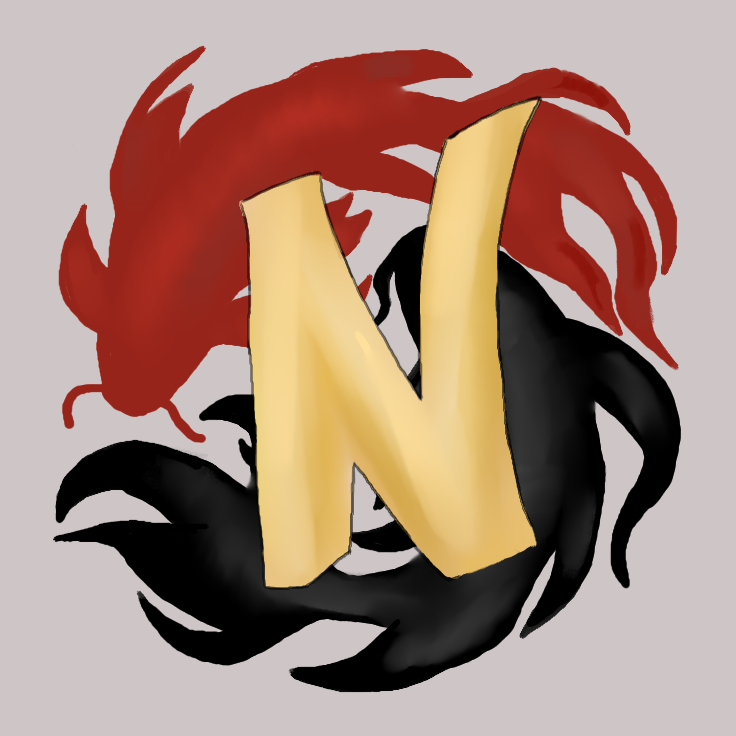

# NindoCraft Modpack

Modpack client pour NindoCraft, sous Minecraft 1.21.10 Fabric.

Les fichiers du modpack sont disponibles dans les Releases.

## Releases

- `modpack-<version>` : une version du modpack (`version.json`, `manifest.json`, `modpack.zip`, `optional-mods.json`, `launcher-assets.json`). Le launcher lit toujours la release **Latest**.
- `launcher-assets` : ressources permanentes du launcher (JARs et icônes des mods optionnels, configurations par défaut, manifeste des images). Pré-version volontaire : elle ne devient jamais Latest et n'est pas une mise à jour du modpack. Les noms contiennent l'empreinte SHA-256 du fichier, qui n'est jamais remplacé. **Ne pas la supprimer.**

Les anciennes releases `modpack-<version>` peuvent être supprimées : aucune version publiée à partir de 1.0.24 n'en dépend.
